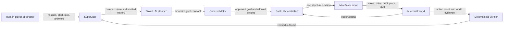

# Minecraft LLM Showrunner

An experimental system that lets large language models control Minecraft characters, pursue verified goals, and perform directed scenes alongside a human player.

The central idea is simple: **the LLM decides what to try, but ordinary code decides what it is allowed to do and whether it actually succeeded.** This keeps the characters flexible without trusting generated text with unrestricted control of Minecraft or the server.

> **Project status:** Research prototype for local Minecraft Java Edition `1.21.4`. One live slow-planner-to-fast-agent handoff has been demonstrated and recorded. The larger multi-goal pipeline and two-actor showrunner are implemented and extensively tested, but still require incremental live-world validation before they should be treated as production-ready.

## Why this project exists

Most Minecraft bots follow a fixed script. This project asks a broader question:

**Can an AI character observe a changing Minecraft world, make its own small decisions, remember verified progress, accept new direction, and participate in a story with a human?**

The long-term goal is a system for creating video content in which:

- human creators provide the premise, boundaries, dialogue style, and high-level direction;
- slower, more thoughtful LLM calls prepare the characters' next goals;
- faster LLM calls react to the world and choose moment-to-moment actions;
- Minecraft characters move, gather, craft, build, fight, and speak in-game; and
- deterministic software verifies progress, enforces limits, and stops safely when evidence is missing.

This repository contains the experiments, runtime code, tests, scene tooling, and operating guides developed toward that goal.

## How it works



The system deliberately separates reasoning from authority:

1. **A human supplies direction.** This can be a mission, a start or stop command, or an answer to a bounded multiple-choice question.
2. **The slow planner creates a goal contract.** It works one goal ahead and describes the objective, completion conditions, and permitted action types.
3. **Code validates the contract.** Unsupported goals, malformed output, excessive budgets, and unsafe transitions fail closed.
4. **The fast controller chooses one action at a time.** It receives compact observations instead of unrestricted access to the whole server.
5. **Mineflayer performs the action.** Mineflayer is a JavaScript library that connects a program to Minecraft as a player character.
6. **Code verifies the result.** The system records bounded state and only marks progress complete when Minecraft evidence satisfies the goal predicate.

The planner and controller currently use the local OpenAI Codex CLI as their LLM provider. A scripted provider is also available for deterministic tests.

## What is in the repository

### LLM survival agent

A persistent single-character runtime that can observe nearby world state and perform bounded actions. Its state survives process restarts, while histories and budgets remain deliberately limited.

### Slow-planner / fast-controller pipeline

The slow model prepares successive goal contracts while the fast model works on the active goal. The supervisor allows one active goal and at most one prepared successor, so planning can continue without creating an unbounded queue.

### Two-actor showrunner

A separate system for coordinating Minecraft characters in directed scenes. It includes approved dialogue, movement cues, rehearsal and take lifecycles, evidence capture, emergency stops, and fail-closed production controls.

### Deterministic scene and world tools

Scripts and datapacks support repeatable sets, large builds, teleports, combat experiments, and cinematic rehearsals when direct block-by-block bot control would be too slow or unreliable.

## What has been demonstrated

- A Mineflayer character can join the local server, observe world state, navigate, chat, manipulate inventory, and perform constrained actions.
- A slow LLM director has selected a bounded goal for a fast LLM agent in a real Minecraft session.
- The fast agent completed the action and the runtime recorded fresh, actor-matched, non-simulated Minecraft evidence.
- A survival progression scene has gathered wood, crafted tools, mined stone, crafted a furnace, traveled toward a village, and delivered a final chat line.
- Two scripted actors can follow paced dialogue and movement cues in a prepared meadow scene.
- State, budgets, recent outcomes, failure fences, and audit events persist across restarts while remaining bounded.
- The automated suite covers contracts, persistence, safety gates, cancellation, verification, and showrunner behavior.

Automated tests prove software behavior; they do **not** prove that a particular live world still has safe terrain, reachable resources, a working route, or correct recording conditions. Live claims require a fresh rehearsal and real-world evidence.

## Quick start

This is currently a macOS-oriented local development project targeting Minecraft Java Edition `1.21.4`.

### Requirements

- Minecraft Java Edition with a `1.21.4` profile
- Java 21, such as Temurin or OpenJDK
- Node.js 22 and npm
- OpenAI Codex CLI for live LLM decisions

### Install

```sh
git clone https://github.com/prithvisinhraol-lab/minecraft-llm-showrunner.git
cd minecraft-llm-showrunner
npm install
cp .env.example .env
npm run download-server
```

Read the [Minecraft EULA](https://aka.ms/MinecraftEULA), then set `eula=true` in `server/eula.txt` before starting the server.

### Run the basic local server and bot

Terminal 1:

```sh
npm run server
```

In Minecraft, connect to:

```text
127.0.0.1:25565
```

Terminal 2:

```sh
npm run bot
```

Useful in-game chat commands include `bot come`, `bot stop`, `bot pos`, `bot look`, and `bot say <message>`.

### Run the LLM agent

```sh
npm run llm-agent
```

The generated-goal pipeline is operated through exact in-game chat commands such as `pipeline start`, `pipeline status`, `pipeline stop`, and `pipeline mission <text>`. Read the [LLM agent operations guide](docs/llm-agent-operations.md) before a live run; it contains the required preflight checks, budgets, recovery steps, and evidence rules.

### Run tests

```sh
npm test
```

## Other runnable experiments

| Command | Purpose |
| --- | --- |
| `npm run survival-demo` | Runs the bounded single-actor survival progression scene. |
| `npm run meadow-live` | Arms the two-actor meadow showrunner and waits for the authorized start mark. |
| `npm run showrunner:rehearse` | Exercises the showrunner rehearsal contract. |
| `npm run movie-war` | Runs a cinematic multi-character experiment. |
| `npm run movie-war-fight` | Runs its combat-focused mode. |
| `npm run generate-flamefrags-base` | Generates the compact FlameFrags-inspired base datapack. |

These experiments do not all share the same safety or maturity level. Follow the relevant runbook instead of combining control paths during a production take.

## Safety and privacy

The included server configuration is for local experimentation. It uses `online-mode=false` so local Mineflayer characters can connect without separate paid Microsoft accounts.

**Do not expose the included server configuration directly to the internet.** Before allowing LAN or public access, enable appropriate authentication and review the whitelist, operator permissions, firewall, command access, secrets, and offline-mode risks.

Runtime state, worlds, recordings, server jars, credentials, and local approval material are intentionally excluded from the public repository.

## Documentation

- [LLM agent operations](docs/llm-agent-operations.md) — pipeline commands, live validation, recovery, and evidence
- [Showrunner operations](docs/showrunner-operations.md) — safe rehearsal and production workflow
- [Showrunner design](docs/superpowers/specs/2026-08-05-llm-video-showrunner-design.md) — approved architecture and production boundaries
- [Showrunner implementation plan](docs/superpowers/plans/2026-08-05-two-actor-showrunner-mvp.md) — staged implementation details
- [Project resume notes](SHOWRUNNER_RESUME.md) — current operational context and restart guidance

## Current boundaries and next steps

This is an evolving research project, not a plug-and-play autonomous player. Important next steps are:

- repeat live validation in small, observable increments;
- broaden the action vocabulary only after existing actions are reliable;
- validate multi-goal planning and goal replacement during real survival play;
- add native production-host adapters for the two-actor showrunner;
- improve recording and camera workflows; and
- preserve the separation between LLM suggestions, deterministic authority, and verified evidence.

Contributions and experiments are welcome, especially when they include a reproducible test, a bounded failure mode, and evidence from a real Minecraft run.

## License

No open-source license has been selected yet. The code is publicly visible, but normal copyright restrictions apply until a license is added.
